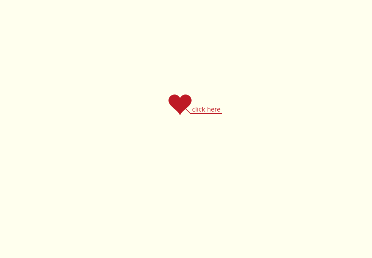

## Love Tree

> <b>Modify the config.js configuration to create your own love tree. If you like it, please fork or star~</b>


### config.js Description
```text
var config = {
    // The sentences below don't have to be 7, you can change to 4, 2 sentences as well
    lines: [
        "Dear Yvonne",
        "Flowers bloom for a season, fallen petals as proof",
        "Past years, how can they be entrusted to dust",
        "Your faint smile is my eternal longing",
        "Can you understand the true feelings of longing",
        "Dear baby, you are my only one",
        "Love you forever...",
    ],
    // Time when you fell in love. Remember the format cannot be wrong, very important
    // The format must be exactly the same as below
    // Year-Month-Day HH:MM:SS
    date: "2017-07-20 20:15:0",
    // Names of both people
    names: ["Benben Bear", "Black Pig"]
}
```

Tip: To change the background music, just replace `index_files/music.mp3` with your own music, but don't change the file name.

If you don't want music, just delete the music.mp3 file.

## Screenshot Demo


## Zhihu Tutorial
Create a free web love tree in 5 minutes, learn quickly and send it to your girlfriend (WeChat and QQ can view it perfectly)^_^ \
https://zhuanlan.zhihu.com/p/72907840

## Ending
If you like it, please follow [霸都丶傲天](https://github.com/ajlovechina)~  \
Regularly update love web templates, resume templates, knowledge notes, PDF books, original deep technical sharing, etc. :heart:

* Zhihu: [霸都丶傲天](https://www.zhihu.com/people/AJLoveChina)
* Github: [霸都丶傲天](https://github.com/ajlovechina)

## Links
* [Part 1: Love Tree 🌴Forever cherish the moment we fell in love (WeChat, QQ can view perfectly)](https://github.com/AJLoveChina/LoveTree)
* [Part 2: :cake:Change the data to create a super creative web birthday wish for your loved one~ (Happy Birthday)](https://github.com/AJLoveChina/birthday)
* [Part 3: :balloon:On the banks of the Seine, coffee on the left bank. Confession balloon, flying into my heart.](https://github.com/AJLoveChina/loveBalloon)
